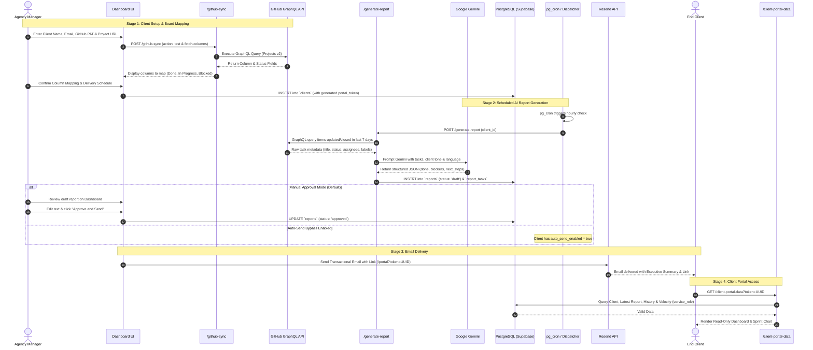

# System Architecture — ClientPulse AI

## 1. Executive Summary & Purpose

ClientPulse AI is a B2B SaaS platform that automates weekly progress reporting for freelancers and small digital agencies (2–10 people). The system connects to **GitHub Projects v2** via GraphQL, extracts task metadata (completed, in-progress, blocked), and uses **Google Gemini** to generate structured, jargon-free 3-block executive reports.

Agency managers review and approve reports in their dashboard, or enable automatic sending. Reports are delivered via **Resend** transactional emails with a secure link to a **zero-login Client Portal**. A conversational assistant (text/voice) guides first-time users through onboarding.

This document describes the end-to-end backend architecture, data flows, security boundaries, and operational risks, specifically tailored for execution by a **1–2 person student backend team** using the **Supabase Free Tier**.

---

## 2. High-Level Architecture Diagram

```mermaid
flowchart TB
    subgraph Clients_Layer["User & Client Interfaces"]
        AgencyUser["Agency Manager (Web Dashboard)"]
        EndClient["End Client (Email & Zero-Login Portal)"]
    end

    subgraph Supabase_Platform["Supabase Infrastructure (Free Tier)"]
        AuthService["Supabase Auth (JWT)"]
        PgDatabase[("PostgreSQL Database\n- Strict Row Level Security (RLS)\n- Indexed JSONB & UUIDs")]
        PgCron["pg_cron Scheduler\n(Periodic UTC Dispatcher)"]
        PgNet["pg_net Extension\n(Asynchronous HTTP POST)"]

        subgraph Edge_Functions_Runtime["Deno / TypeScript Edge Functions"]
            FnOnboarding["/onboarding-chat\n(Gemini Onboarding Assistant)"]
            FnGithubSync["/github-sync\n(PAT Validator & GraphQL Sync)"]
            FnGenerate["/generate-report\n(Gemini 3-Block Report Synthesizer)"]
            FnApproveSend["/approve-and-send\n(Review, Update & Resend Dispatch)"]
            FnPortalData["/client-portal-data\n(Token-Authenticated Public API)"]
            FnDispatchCron["/dispatch-scheduled-reports\n(Cron Batch Dispatcher)"]
            
            subgraph Shared_Modules["_shared/ (Reusable Helpers)"]
                ModCors["cors.ts"]
                ModClient["supabaseClient.ts"]
                ModGemini["gemini.ts"]
                ModGithub["github.ts"]
                ModResend["resend.ts"]
            end
        end
    end

    subgraph External_APIs["External SaaS & APIs"]
        GitHubAPI["GitHub Projects v2\n(GraphQL API)"]
        GeminiAPI["Google Gemini API\n(Google AI Studio)"]
        ResendAPI["Resend Email Service\n(Transactional SMTP/API)"]
    end

    %% User Interactions
    AgencyUser -->|1. Sign in / Sign up| AuthService
    AgencyUser -->|2. Manage Clients & View Drafts| PgDatabase
    AgencyUser -->|3. Onboarding Chat (Text/Voice)| FnOnboarding
    AgencyUser -->|4. Test & Connect GitHub PAT| FnGithubSync
    AgencyUser -->|5. Manually Trigger Draft| FnGenerate
    AgencyUser -->|6. Approve & Send Report| FnApproveSend

    %% Portal Interactions
    EndClient -->|7. Open Portal via Link with Token| FnPortalData

    %% Function External Calls
    FnOnboarding -->|Validate PAT & Query Board| GitHubAPI
    FnOnboarding -->|Chat Guidance & Intent| GeminiAPI
    FnGithubSync -->|GraphQL Queries (Projects v2)| GitHubAPI
    FnGenerate -->|Extract Task Metadata| GitHubAPI
    FnGenerate -->|Structured Report Generation| GeminiAPI
    FnGenerate -->|Store Draft Report & Tasks| PgDatabase
    FnApproveSend -->|Update Status & Send Email| ResendAPI
    FnApproveSend -->|Fetch Client & Token| PgDatabase
    FnPortalData -->|Fetch Client, Reports & Metrics (service_role)| PgDatabase
    ResendAPI -->|Deliver HTML Email with Token Link| EndClient

    %% Automated Dispatcher
    PgCron -->|Triggers at scheduled hour| PgNet
    PgNet -->|HTTP POST with Service Key| FnDispatchCron
    FnDispatchCron -->|Query Due Clients| PgDatabase
    FnDispatchCron -->|Trigger Generation / Auto-Send| FnGenerate
```

---

## 3. Core Modules & Responsibilities

To keep development manageable for 1–2 developers, the backend is strictly divided into isolated, single-responsibility modules:

| Module | Location | Primary Responsibility |
| :--- | :--- | :--- |
| **Database & Security** | `supabase/migrations/` | Schema definition, foreign keys, cascading deletes, indexes, and Row Level Security (RLS) policies. |
| **GitHub Integration** | `supabase/functions/github-sync/` & `_shared/github.ts` | Validates GitHub PATs, executes GraphQL queries against Projects v2 (user & org levels), and maps custom board columns to standard status categories (`done`, `in_progress`, `blocked`). |
| **AI Report Engine** | `supabase/functions/generate-report/` & `_shared/gemini.ts` | Builds few-shot prompts with task metadata, invokes Google Gemini with strict structured JSON schemas, validates response integrity, and stores 3-block reports. |
| **Approval & Dispatch** | `supabase/functions/approve-and-send/` & `_shared/resend.ts` | Allows the agency manager to modify the draft, marks report status as `approved`/`sent`, generates responsive HTML email, and dispatches via Resend. |
| **Zero-Login Portal** | `supabase/functions/client-portal-data/` | Public HTTP endpoint that accepts a client UUID token, validates it against `clients.portal_token`, and returns the latest report, historical archive, and sprint velocity data. |
| **Scheduling Engine** | `supabase/functions/dispatch-scheduled-reports/` | Hourly batch job invoked by `pg_cron` via `pg_net`. Scans `clients` for matching schedule windows, initiates report generation, and handles automatic direct sending (`auto_send_enabled`). |
| **Onboarding Chat** | `supabase/functions/onboarding-chat/` | Conversational assistant powered by Gemini. Guides the user step-by-step through generating a GitHub PAT, verifying permissions, and creating their first client profile. |

---

## 4. End-to-End Data Flow

The complete operational lifecycle follows five distinct stages:



---

## 5. Authentication & Security Architecture

### 5.1 Agency Authentication (Supabase Auth)
- Agency managers authenticate using standard Supabase Auth (Email + Password or OAuth).
- Upon successful authentication, Supabase returns a JSON Web Token (JWT) containing the user's `auth.uid()`.
- Every Edge Function invoked by the agency dashboard validates this JWT using `supabase.auth.getUser()`.

### 5.2 Row Level Security (RLS) Boundary
- Every table (`agencies`, `github_integrations`, `clients`, `reports`, `report_tasks`) has PostgreSQL Row Level Security enabled (`ENABLE ROW LEVEL SECURITY`).
- Policies guarantee strict multi-tenant isolation:
  ```sql
  -- Example policy: Users can only see clients belonging to their agency
  CREATE POLICY "Agencies can only access their own clients"
  ON clients FOR ALL
  TO authenticated
  USING (
    agency_id IN (SELECT id FROM agencies WHERE user_id = auth.uid())
  );
  ```
- No user can read, insert, update, or delete data belonging to another agency, even if they manipulate client-side code.

### 5.3 Zero-Login Client Portal Security
- The end-client portal **never accesses the PostgreSQL database directly**.
- It communicates exclusively with the `/client-portal-data` Edge Function.
- Access is authenticated via an unguessable 128-bit UUIDv4 token (`portal_token`).
- The Edge Function uses Supabase `service_role` internally to locate the specific client matching that exact token. If no match is found, it returns `404 Not Found` without disclosing database details.
- Agency managers can rotate/regenerate the client's `portal_token` at any time from the dashboard if a link is compromised.

### 5.4 Secret & Credential Management
- Sensitive keys are never committed to git:
  - `GEMINI_API_KEY`: Stored in Supabase Vault / Edge Function Secrets.
  - `RESEND_API_KEY`: Stored in Supabase Secrets.
  - `SUPABASE_SERVICE_ROLE_KEY`: Used only inside server-side Edge Functions.
- GitHub Personal Access Tokens (PAT) are stored in `github_integrations` and accessed only by backend functions.

---

## 6. Technical Risks & Mitigation Strategies

| Risk | Impact | Probability | Mitigation Strategy |
| :--- | :--- | :--- | :--- |
| **Gemini Hallucinations or Schema Deviation** | Reports contain invented tasks or invalid formatting. | Medium | Use Gemini 2.5 Flash with structured output schemas (`responseSchema: { type: "object", properties: {...} }`). Set `temperature: 0.2` and inject strict system instructions: *"Only summarize tasks present in the input JSON. Never invent features or milestones."* |
| **Resend Free-Tier Domain Limits** | Cannot send emails to external client domains during testing. | High | Implement a **Mock/Preview Mode** in `resend.ts`: when running in development or without a custom domain, log the rendered email HTML to Supabase Studio or send only to the developer's registered email (`onboarding@resend.dev`). |
| **GitHub GraphQL API Quota & Changes** | GraphQL queries fail or rate-limit the agency account. | Low | Query only necessary fields (`title`, `state`, `assignees`, `labels`, `updatedAt`, `closedAt`) with pagination limits (`first: 100`). Cache raw responses in `reports.raw_github_data`. |
| **`pg_cron` UTC Scheduling Offsets** | Reports generate at the wrong hour due to timezone differences. | Medium | Store all schedule definitions with an explicit UTC hour (`schedule_hour_utc: 9`). Document for the user that 09:00 UTC corresponds to 10:00 Lisbon/London time (or 09:00 WET). |
| **Small Team Bottleneck (1–2 Developers)** | Overengineering leads to incomplete MVP features at week 5. | High | Rely on standard Supabase conventions (no custom Docker containers, no complex microservices). Keep Edge Functions focused on single tasks and share common logic through `_shared/`. |

---

## 7. Developer Guidelines for 1–2 Person Team

1. **One Function, One Responsibility:** Never combine unrelated tasks into a single giant Edge Function.
2. **Migrations Over Dashboard Edits:** Never alter table schemas in the Supabase web dashboard without saving the corresponding SQL in `supabase/migrations/`.
3. **Local First Testing:** Test Edge Functions locally using `supabase functions serve <function-name>` before deploying to remote Supabase projects.
4. **Descriptive Comments:** Write comments that explain the business *why*, not just the technical *what*, so your team partner can easily review your pull requests.
