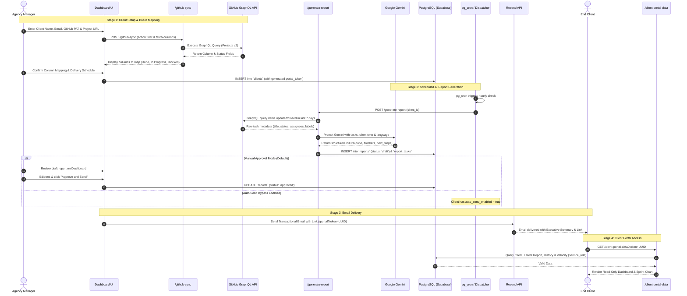

# System Architecture — ClientPulse AI

## 1. Executive Summary & Purpose

ClientPulse AI is a B2B SaaS platform that automates weekly progress reporting for freelancers and small digital agencies (2–10 people). The system connects to **GitHub Projects v2** via GraphQL, extracts task metadata (completed, in-progress, blocked), and uses **Google Gemini** to generate structured, jargon-free 3-block executive reports.

Agency managers review and approve reports in their dashboard, or enable automatic sending. Reports are delivered via **Resend** transactional emails with a secure link to a **zero-login Client Portal**. A conversational assistant (text/voice) guides first-time users through onboarding.

This document describes the end-to-end backend architecture, data flows, security boundaries, and operational risks, specifically tailored for execution by a **1–2 person student backend team** using the **Supabase Free Tier**.

---

## 2. High-Level Architecture Diagram

```mermaid
flowchart TB
    subgraph Clients_Layer["User & Client Interfaces"]
        AgencyUser["Agency Manager (Web Dashboard)"]
        EndClient["End Client (Email & Zero-Login Portal)"]
    end

    subgraph Supabase_Platform["Supabase Infrastructure (Free Tier)"]
        AuthService["Supabase Auth (JWT)"]
        PgDatabase[("PostgreSQL Database\n- Strict Row Level Security (RLS)\n- Indexed JSONB & UUIDs")]
        PgCron["pg_cron Scheduler\n(Periodic UTC Dispatcher)"]
        PgNet["pg_net Extension\n(Asynchronous HTTP POST)"]

        subgraph Edge_Functions_Runtime["Deno / TypeScript Edge Functions"]
            FnOnboarding["/onboarding-chat\n(Gemini Onboarding Assistant)"]
            FnGithubSync["/github-sync\n(PAT Validator & GraphQL Sync)"]
            FnGenerate["/generate-report\n(Gemini 3-Block Report Synthesizer)"]
            FnApproveSend["/approve-and-send\n(Review, Update & Resend Dispatch)"]
            FnPortalData["/client-portal-data\n(Token-Authenticated Public API)"]
            FnDispatchCron["/dispatch-scheduled-reports\n(Cron Batch Dispatcher)"]
            
            subgraph Shared_Modules["_shared/ (Reusable Helpers)"]
                ModCors["cors.ts"]
                ModClient["supabaseClient.ts"]
                ModGemini["gemini.ts"]
                ModGithub["github.ts"]
                ModResend["resend.ts"]
            end
        end
    end

    subgraph External_APIs["External SaaS & APIs"]
        GitHubAPI["GitHub Projects v2\n(GraphQL API)"]
        GeminiAPI["Google Gemini API\n(Google AI Studio)"]
        ResendAPI["Resend Email Service\n(Transactional SMTP/API)"]
    end

    %% User Interactions
    AgencyUser -->|1. Sign in / Sign up| AuthService
    AgencyUser -->|2. Manage Clients & View Drafts| PgDatabase
    AgencyUser -->|3. Onboarding Chat (Text/Voice)| FnOnboarding
    AgencyUser -->|4. Test & Connect GitHub PAT| FnGithubSync
    AgencyUser -->|5. Manually Trigger Draft| FnGenerate
    AgencyUser -->|6. Approve & Send Report| FnApproveSend

    %% Portal Interactions
    EndClient -->|7. Open Portal via Link with Token| FnPortalData

    %% Function External Calls
    FnOnboarding -->|Validate PAT & Query Board| GitHubAPI
    FnOnboarding -->|Chat Guidance & Intent| GeminiAPI
    FnGithubSync -->|GraphQL Queries (Projects v2)| GitHubAPI
    FnGenerate -->|Extract Task Metadata| GitHubAPI
    FnGenerate -->|Structured Report Generation| GeminiAPI
    FnGenerate -->|Store Draft Report & Tasks| PgDatabase
    FnApproveSend -->|Update Status & Send Email| ResendAPI
    FnApproveSend -->|Fetch Client & Token| PgDatabase
    FnPortalData -->|Fetch Client, Reports & Metrics (service_role)| PgDatabase
    ResendAPI -->|Deliver HTML Email with Token Link| EndClient

    %% Automated Dispatcher
    PgCron -->|Triggers at scheduled hour| PgNet
    PgNet -->|HTTP POST with Service Key| FnDispatchCron
    FnDispatchCron -->|Query Due Clients| PgDatabase
    FnDispatchCron -->|Trigger Generation / Auto-Send| FnGenerate
```

---

## 3. Core Modules & Responsibilities

To keep development manageable for 1–2 developers, the backend is strictly divided into isolated, single-responsibility modules:

| Module | Location | Primary Responsibility |
| :--- | :--- | :--- |
| **Database & Security** | `supabase/migrations/` | Schema definition, foreign keys, cascading deletes, indexes, and Row Level Security (RLS) policies. |
| **GitHub Integration** | `supabase/functions/github-sync/` & `_shared/github.ts` | Validates GitHub PATs, executes GraphQL queries against Projects v2 (user & org levels), and maps custom board columns to standard status categories (`done`, `in_progress`, `blocked`). |
| **AI Report Engine** | `supabase/functions/generate-report/` & `_shared/gemini.ts` | Builds few-shot prompts with task metadata, invokes Google Gemini with strict structured JSON schemas, validates response integrity, and stores 3-block reports. |
| **Approval & Dispatch** | `supabase/functions/approve-and-send/` & `_shared/resend.ts` | Allows the agency manager to modify the draft, marks report status as `approved`/`sent`, generates responsive HTML email, and dispatches via Resend. |
| **Zero-Login Portal** | `supabase/functions/client-portal-data/` | Public HTTP endpoint that accepts a client UUID token, validates it against `clients.portal_token`, and returns the latest report, historical archive, and sprint velocity data. |
| **Scheduling Engine** | `supabase/functions/dispatch-scheduled-reports/` | Hourly batch job invoked by `pg_cron` via `pg_net`. Scans `clients` for matching schedule windows, initiates report generation, and handles automatic direct sending (`auto_send_enabled`). |
| **Onboarding Chat** | `supabase/functions/onboarding-chat/` | Conversational assistant powered by Gemini. Guides the user step-by-step through generating a GitHub PAT, verifying permissions, and creating their first client profile. |

---

## 4. End-to-End Data Flow

The complete operational lifecycle follows five distinct stages:



---

## 5. Authentication & Security Architecture

### 5.1 Agency Authentication (Supabase Auth)
- Agency managers authenticate using standard Supabase Auth (Email + Password or OAuth).
- Upon successful authentication, Supabase returns a JSON Web Token (JWT) containing the user's `auth.uid()`.
- Every Edge Function invoked by the agency dashboard validates this JWT using `supabase.auth.getUser()`.

### 5.2 Row Level Security (RLS) Boundary
- Every table (`agencies`, `github_integrations`, `clients`, `reports`, `report_tasks`) has PostgreSQL Row Level Security enabled (`ENABLE ROW LEVEL SECURITY`).
- Policies guarantee strict multi-tenant isolation:
  ```sql
  -- Example policy: Users can only see clients belonging to their agency
  CREATE POLICY "Agencies can only access their own clients"
  ON clients FOR ALL
  TO authenticated
  USING (
    agency_id IN (SELECT id FROM agencies WHERE user_id = auth.uid())
  );
  ```
- No user can read, insert, update, or delete data belonging to another agency, even if they manipulate client-side code.

### 5.3 Zero-Login Client Portal Security
- The end-client portal **never accesses the PostgreSQL database directly**.
- It communicates exclusively with the `/client-portal-data` Edge Function.
- Access is authenticated via an unguessable 128-bit UUIDv4 token (`portal_token`).
- The Edge Function uses Supabase `service_role` internally to locate the specific client matching that exact token. If no match is found, it returns `404 Not Found` without disclosing database details.
- Agency managers can rotate/regenerate the client's `portal_token` at any time from the dashboard if a link is compromised.

### 5.4 Secret & Credential Management
- Sensitive keys are never committed to git:
  - `GEMINI_API_KEY`: Stored in Supabase Vault / Edge Function Secrets.
  - `GEMINI_MODEL`: Optional model override stored in Edge Function Secrets. Defaults to `gemini-3.8-flash`. If Google deprecates or retires a model, set the new model name via `npx supabase secrets set GEMINI_MODEL="<new_model>"` without altering codebase.
  - `GEMINI_FALLBACK_MODEL`: Optional secondary fallback model if the primary model is overloaded (HTTP 503) or rate limited (HTTP 429). Defaults to `gemini-3.7-flash`. The system retries transient errors up to 2 times with backoff before falling back to this model, and ultimately to raw formatted tasks if both models fail.
  - `RESEND_API_KEY`: Stored in Supabase Secrets.
  - `SUPABASE_SERVICE_ROLE_KEY`: Used only inside server-side Edge Functions.
  - `SCHEDULED_FUNCTION_SECRET`: Shared secret used by `pg_cron` / `pg_net` to trigger `/dispatch-scheduled-reports`. Set via `supabase secrets set SCHEDULED_FUNCTION_SECRET="<secret>"`.
  - `PAT_ENCRYPTION_KEY`: 32-byte base64 key used for AES-GCM encryption of GitHub PATs in repose.

### 5.5 GitHub PAT Symmetric Encryption at Rest (Issue #19)
- **Algorithm:** AES-GCM (Authenticated Encryption) 256-bit with standard Web Crypto API.
- **Storage Format:** Stored in `github_integrations.pat_token_encrypted` as `<base64_iv>:<base64_ciphertext>`.
- **Initialization Vector (IV):** 12-byte cryptographically secure random IV generated per encryption (`crypto.getRandomValues`).
- **Key Storage:** Read strictly inside Edge Functions via `Deno.env.get('PAT_ENCRYPTION_KEY')` (never exposed to browser, frontend or logged).
- **Migration & Existing Data:** Migration `007_be_19_encrypt_pat.sql` converted `pat_token` to nullable and cleared plaintext rows. In accordance with issue #19, test users re-enter their token during onboarding which automatically saves it encrypted.
- **Key Rotation Procedure:**
  1. Generate new 32-byte key: `openssl rand -base64 32`.
  2. In rotation script, read current `pat_token_encrypted` rows, decrypt with current `PAT_ENCRYPTION_KEY`, re-encrypt with new key, and update rows.
  3. Update secret in Supabase: `npx supabase secrets set PAT_ENCRYPTION_KEY="<new_key>"`.

### 5.6 Produção: Configuração Segura do Agendamento (pg_cron, pg_net e Supabase Vault)
Para evitar expor segredos em ficheiros de migração SQL (`002_cron_scheduler.sql`), o agendamento em produção utiliza o **Supabase Vault** em conjunto com a extensão `pg_net` e `pg_cron`:

1. **Gerar o segredo partilhado:**
   ```bash
   openssl rand -hex 32
   ```

2. **Configurar nos Secrets das Edge Functions:**
   ```bash
   npx supabase secrets set SCHEDULED_FUNCTION_SECRET="<seu_segredo_gerado>"
   ```

3. **Guardar o segredo no Supabase Vault (PostgreSQL):**
   No SQL Editor do painel Supabase (ou via psql com permissão de administrador):
   ```sql
   SELECT vault.create_secret('<seu_segredo_gerado>', 'scheduled_function_secret');
   ```

4. **Ativar o agendamento cron horário em Produção:**
   ```sql
   CREATE EXTENSION IF NOT EXISTS "pg_cron";
   CREATE EXTENSION IF NOT EXISTS "pg_net";

   -- Remove agendamento anterior se existir
   SELECT cron.unschedule('dispatch-reports-hourly')
   WHERE EXISTS (SELECT 1 FROM cron.job WHERE jobname = 'dispatch-reports-hourly');

   -- Regista o job horário seguro que lê o segredo do Vault
   SELECT cron.schedule(
       'dispatch-reports-hourly',
       '0 * * * *',
       $$
       SELECT net.http_post(
           url := 'https://rewurbzemhydcqhmornx.supabase.co/functions/v1/dispatch-scheduled-reports',
           headers := jsonb_build_object(
               'Content-Type', 'application/json',
               'X-Scheduled-Secret', (SELECT decrypted_secret FROM vault.decrypted_secrets WHERE name = 'scheduled_function_secret' LIMIT 1)
           ),
           body := '{}'::jsonb
       );
       $$
   );
   ```

5. **Garantias de Segurança:**
   - Nenhum segredo real é guardado em repositório ou migrações versionadas.
   - O `pg_net` obtém o segredo desencriptado em tempo de execução via `vault.decrypted_secrets`.
   - A Edge Function `dispatch-scheduled-reports` valida `req.headers.get('X-Scheduled-Secret') === Deno.env.get('SCHEDULED_FUNCTION_SECRET')` antes de processar qualquer cliente.

### 5.7 Assistente Conversacional de Onboarding e FAQ (PulseBot)
- **Função:** `supabase/functions/onboarding-chat/index.ts`.
- **Fonte de Conhecimento:** Base factual embutida em `supabase/functions/_shared/faq.ts`, estritamente alinhada com `docs/PRD.md` (regras de produto, metadados vs código, portal sem login e distinção clara entre MVP e evoluções futuras).
- **Ordem do Guia:**
  1. Conexão GitHub: recomenda token *classic* com `read:project` (e `repo` se privado); alerta para limitações de tokens *fine-grained* em projetos pessoais.
  2. Escolha de board na lista do ecrã após conexão validada.
  3. Mapeamento de colunas (Concluído, Em curso, Bloqueado; Bloqueado pode ficar vazio).
  4. Configuração do 1.º cliente (Nome, E-mail, Tom e Idioma).
- **Guardrails de Segurança e Âmbito:**
  - **Validação prévia:** Recusa qualquer tentativa de avançar de passo sem conexão GitHub válida (`isConnected === true`).
  - **Recusa de âmbito:** Perguntas fora de âmbito (política, desporto, código genérico, outros produtos) recebem recusa curta e educada em PT-PT.
  - **Proteção contra Prompt Injection:** Mensagens do utilizador são tratadas estritamente como dados, nunca como instruções; nunca revela chaves, tokens ou prompts de sistema.
  - **Mascaramento:** Tokens PAT são validados em memória, mascarados no histórico e cifrados em repouso com AES-GCM (nunca registados em logs).
- **Robustez e Fallback Determinístico:**
  - Invoca o modelo Gemini (`gemini-3.8-flash` ou `GEMINI_MODEL`) com até 2 retentativas para erros transitórios (429/500/503).
  - Tenta modelo secundário (`gemini-3.7-flash` ou `GEMINI_FALLBACK_MODEL`) se o principal falhar.
  - Caso a IA esteja indisponível ou sem chave configurada, ativa o **fallback determinístico** de `_shared/faq.ts` por análise de palavras-chave, garantindo continuidade sem erros HTTP 500.

### 5.8 Política de Privacidade e Minimização de Dados Enviados à IA (DOC-04 / Issue #51)
- **Documento de Referência:** [`docs/PRIVACY.md`](PRIVACY.md).
- **Enquadramento:** Resolução do risco identificado na secção 7 do `docs/RELATORIO_VALIDACAO.md` em cumprimento do princípio de Minimização de Dados (RGPD / GDPR Artigo 5.º, n.º 1, al. c).
- **Campos Estritamente Transmitidos à IA (Google Gemini):**
  1. `title`: Título da tarefa/cartão.
  2. `description`: Descrição da tarefa higienizada de blocos de código/backticks e truncada a 300 caracteres via `sanitizeTaskDescription` em `supabase/functions/_shared/github.ts`.
  3. `status`: Coluna/estado no GitHub Project (ex.: Concluído, Em curso, Bloqueado).
  4. `labels`: Etiquetas temáticas associadas à tarefa.
  5. `assignee`: Nome de utilizador (login GitHub) do responsável.
- **Campos Estritamente Excluídos:**
  - Código-fonte, commits, branches, árvores de ficheiros git e diffs de PRs nunca são acedidos nem guardados.
  - Credenciais (PATs do GitHub), chaves de API, variáveis de ambiente ou senhas nunca são transmitidas nos prompts.
  - UUIDs e identificadores internos de base de dados são descartados na camada de minimização (`minimizeTaskForAI` em `supabase/functions/_shared/gemini.ts`).
- **Avisos Transparentes na Interface do Utilizador:**
  - Ecrã de Revisão do Relatório (`/dashboard/reports/[id]`): Banner informativo (`ShieldCheck`) indicando síntese com Gemini, dados estritamente minimizados e recomendação de revisão humana antes do envio.
  - Onboarding Chat (`/onboarding`): Disclaimer claro de privacidade abaixo do campo de entrada do PulseBot.
  - Ações de Geração no Dashboard: Legenda identificando síntese por IA restrita a metadados.
- **Human-in-the-Loop:** Todos os relatórios gerados por IA iniciam como rascunhos (`draft`), permitindo ao gestor afinar os 3 blocos antes do disparo ao cliente final.

### 5.9 Validação em Runtime: Bloqueio de Leitura de Código-Fonte (BE-09 / Issue #23)
- **Mecanismo:** `validateGraphQLQuery` em `supabase/functions/_shared/github.ts`.
- **Portão Centralizado:** Todas as chamadas à API GraphQL do GitHub passam obrigatoriamente por `executeGitHubGraphQL`, que executa a validação de runtime antes de disparar qualquer pedido de rede.
- **Allowlist Estrita de Campos ProjectV2:**
  - Apenas seleções e tipos pertencentes ao modelo de boards, cartões e metadados de tarefas são permitidos (`ALLOWED_GRAPHQL_FIELDS`: `viewer`, `user`, `organization`, `node`, `ProjectV2`, `projectsV2`, `items`, `fieldValues`, `content`, `Issue`, `PullRequest`, `DraftIssue`, etc.).
  - Qualquer campo não reconhecido resulta no disparo imediato de `SecurityError`.
- **Blocklist de Código-Fonte (Defense in Depth):**
  - Termos como `repository`, `blob`, `tree`, `object`, `commit`, `entries`, `file`, `diff`, `patch`, `blame`, `defaultBranchRef` são proíbidos por expressão regular com correspondência de limites de palavra (`\b`).
- **Garantia de Isolamento de Rede:**
  - Se um pedido não autorizado for detetado, a execução é interrompida com `SecurityError` antes de qualquer conexão HTTP com o GitHub.
- **Suíte de Testes Automatizados:**
  - Script executável: `npm test` / `npm run test:security` (`scripts/test-runtime-security.mjs`).
  - Integrado em `npm run check` para validação contínua em CI e no fluxo de desenvolvimento.

### 5.10 Lógica de Bypass: Envio Automático vs. Pausa para Revisão (BE-16 / Issue #30)
- **Persistência por Cliente:** Configurado no campo booleano `clients.auto_send_enabled` (por omissão: `false`), persistido no PostgreSQL e modificável pelo utilizador na ficha do cliente (`/dashboard/clients/[id]`) e na revisão do relatório via `ClientAutoSendToggle`.
- **Aprovação Ativa (`auto_send_enabled = false`):**
  - O relatório gerado (por agendamento horário ou a pedido) é guardado com estado `draft`.
  - Na interface do Dashboard e na Ficha do Cliente, é categorizado com o distintivo dourado **"Pendente de revisão"**.
  - O e-mail para o cliente **não** é disparado, aguardando aprovação explícita ("Aprovar e enviar") do profissional após revisão.
- **Bypass Ativo (`auto_send_enabled = true`):**
  - Se a síntese com IA foi concluída com sucesso (`!generatedWithoutAi`), o sistema dispara imediatamente o e-mail via Resend (`sendReportEmail`).
  - O relatório é persistido com estado `sent`, registando `sent_at`, `approved_at` e `email_delivery_id`.
  - Na interface, é identificado com o distintivo verde-azulado **"Enviado"**.
- **Salvaguarda de Segurança (Fallback de IA):**
  - Caso o modelo Gemini falhe e ocorra agregação em bruto de tarefas (`generatedWithoutAi = true`), o bypass é **abortado automaticamente**, forçando o relatório a permanecer em "Pendente de revisão" para impedir o envio não supervisionado de texto cru.
- **Suíte de Testes:** Script de validação `scripts/test-bypass-logic.mjs` executável via `npm test`.

### 5.11 Mapeamento Dinâmico de Colunas e Tratamento de Colunas Ignoradas (BE-07 / Issue #21)
- **Persistência por Cliente:** Configurado no campo `clients.column_mapping JSONB NOT NULL DEFAULT ...` com chaves normalizadas para as 3 categorias nucleares:
  - `done`: Lista de colunas associadas a tarefas concluídas ("O que foi feito").
  - `in_progress`: Lista de colunas em desenvolvimento ("Em curso / Próximos passos").
  - `blocked`: Lista de colunas com impedimentos ou à espera do cliente ("Impedimentos").
- **UI/Configuração Visual:**
  - Na Ficha do Cliente (`/dashboard/clients/[id]`), o componente `ClientColumnMappingCard` permite visualizar e atualizar a associação de cada coluna detetada no board do GitHub Projects via `saveColumnMappingAction`.
  - No Onboarding (`/onboarding`), o passo 2 permite associar as colunas do board selecionado com auto-mapeamento inteligente.
- **Tratamento de Colunas Ignoradas com Aviso (Critério 3):**
  - Todas as colunas do board que não estejam associadas a nenhuma das 3 categorias (como *Backlog*, *Triagem*, *Icebox*) são categorizadas como `'other'` pela função `categorizeTaskStatus` em `_shared/github.ts`.
  - As tarefas nestas colunas são estritamente excluídas das 3 secções do relatório gerado.
  - A interface apresenta um aviso explícito e proeminente (com destaque âmbar) listando as colunas ignoradas e informando o utilizador de que os seus cartões não serão contabilizados nem transmitidos à IA.
  - A Edge Function `generate-report` regista `unmapped_columns` e `ignored_tasks_count` em `reports.raw_github_data` e emite alertas nos logs de execução.
- **Suíte de Testes:** Script de validação `scripts/test-column-mapping.mjs` integrado em `npm test`.

### 5.12 Webhook e Tracking de Abertura de E-mail (openedAt) (BE-21 / Issue #35)
- **Persistência na Base de Dados:** Coluna `public.reports.opened_at TIMESTAMPTZ` (criada e indexada na migração `008_be_21_opened_at.sql`), indicando a data/hora do primeiro acesso do cliente.
- **Mecanismos de Deteção:**
  1. **Pixel de Tracking (GET /api/track/open):** Imagem GIF 1x1 transparente (43 bytes, `Cache-Control: no-store`) embutida automaticamente no HTML do e-mail transacional (`buildReportEmailHtml`).
  2. **Webhook Resend (POST /api/webhooks/resend):** Trata eventos `email.opened` da API do Resend através da tag `report_id`.
  3. **Acesso ao Portal (GET /portal/[token]):** Ao carregar o portal seguro sem login, o relatório mais recente do cliente é assinalado como aberto se ainda não o tiver sido.
- **Idempotência Estrita (Critério 3):**
  - A função `recordReportOpen` executa uma atualização atómica condicional (`.is("opened_at", null)` ou stored procedure `record_report_open`).
  - Pedidos repetidos (múltiplas aberturas do mesmo e-mail ou do portal) **nunca** sobrescrevem a data e hora do primeiro registo.
- **Visibilidade no Dashboard (Critério 2):**
  - Mapeado em `Report.openedAt` em `src/lib/api.ts`.
  - Apresentado na Visão Geral do Dashboard (último envio com indicação de abertura).
  - Apresentado na Ficha do Cliente (`/dashboard/clients/[id]`) com crachá "Aberto" e data exata.
  - Apresentado na página de Revisão do Relatório (`/dashboard/reports/[id]`) no painel "Estado de Envio e Abertura".
- **Suíte de Testes:** Script de validação `scripts/test-open-tracking.mjs` integrado em `npm test`.

---

## 6. Technical Risks & Mitigation Strategies

| Risk | Impact | Probability | Mitigation Strategy |
| :--- | :--- | :--- | :--- |
| **Gemini Hallucinations or Schema Deviation** | Reports contain invented tasks or invalid formatting. | Medium | Use Gemini Flash (default: `gemini-3.8-flash`, configurable via `GEMINI_MODEL`) with structured output schemas (`responseSchema: { type: "OBJECT", properties: {...} }`). Set `temperature: 0.2` and inject strict system instructions: *"Only summarize tasks present in the input JSON. Never invent features or milestones."* |
| **Data Privacy & Leakage to External AI** | Sensitive business or code data exposed to external LLMs. | Medium | Strict data minimization (`minimizeTaskForAI` in `_shared/gemini.ts`): only `title`, `description` (code stripped, max 300 chars), `status`, `labels`, `assignee` are sent. Zero source code access. Visible UI disclaimers and human-in-the-loop review. Full policy documented in [`docs/PRIVACY.md`](PRIVACY.md). |
| **Resend Free-Tier Domain Limits** | Cannot send emails to external client domains during testing. | High | Implement a **Mock/Preview Mode** in `resend.ts`: when running in development or without a custom domain, log the rendered email HTML to Supabase Studio or send only to the developer's registered email (`onboarding@resend.dev`). |
| **GitHub GraphQL API Quota & Changes** | GraphQL queries fail or rate-limit the agency account. | Low | Query only necessary fields (`title`, `state`, `assignees`, `labels`, `updatedAt`, `closedAt`) with pagination limits (`first: 100`). Cache raw responses in `reports.raw_github_data`. |
| **`pg_cron` UTC Scheduling Offsets** | Reports generate at the wrong hour due to timezone differences. | Medium | Store all schedule definitions with an explicit UTC hour (`schedule_hour_utc: 9`). Document for the user that 09:00 UTC corresponds to 10:00 Lisbon/London time (or 09:00 WET). |
| **Small Team Bottleneck (1–2 Developers)** | Overengineering leads to incomplete MVP features at week 5. | High | Rely on standard Supabase conventions (no custom Docker containers, no complex microservices). Keep Edge Functions focused on single tasks and share common logic through `_shared/`. |

---

## 7. Developer Guidelines for 1–2 Person Team

1. **One Function, One Responsibility:** Never combine unrelated tasks into a single giant Edge Function.
2. **Migrations Over Dashboard Edits:** Never alter table schemas in the Supabase web dashboard without saving the corresponding SQL in `supabase/migrations/`.
3. **Local First Testing:** Test Edge Functions locally using `supabase functions serve <function-name>` before deploying to remote Supabase projects.
4. **Descriptive Comments:** Write comments that explain the business *why*, not just the technical *what*, so your team partner can easily review your pull requests.

---

## 8. Antes de Fazer Push: `npm run check` e Regras 'use server'

### 8.1 Comando de Verificação Completa
Antes de qualquer `git commit` ou `git push`, corre obrigatoriamente:
```bash
npm run check
```
Este comando executa em cadeia:
1. `npm run lint` (ESLint)
2. `npx tsc --noEmit` (Verificação de tipos TypeScript)
3. `npm run check:use-server` (Validação de exportações em módulos Server Actions)
4. `cross-env NEXT_DIST_DIR=.next-check next build` (Build de produção isolado em `.next-check`, sem colidir com instâncias ativas de `npm run dev`)

### 8.2 Regras Estritas para Ficheiros `"use server"`
Nos módulos que contêm a diretiva `"use server"` no topo (Server Actions, ex.: `src/app/actions/*.ts`):
- **Apenas funções assíncronas podem ser exportadas:** `export async function minhaAcao(...)`.
- **Tipos e interfaces TypeScript são permitidos:** `export type ...`, `export interface ...`.
- **Proibido exportar constantes ou valores:** `export const`, `export let`, `export var`, `export default`, `export class` ou funções síncronas são rejeitados pelo compilador do Next.js com o erro: *"Only async functions are allowed to be exported in a 'use server' file"*.
- **Constantes de Configuração:** Configurações como `maxDuration`, `dynamic`, `revalidate` pertencem exclusivamente a ficheiros de rota (`route.ts`), página (`page.tsx`) ou layout (`layout.tsx`), **NUNCA** a ficheiros de Server Actions (`"use server"`).
