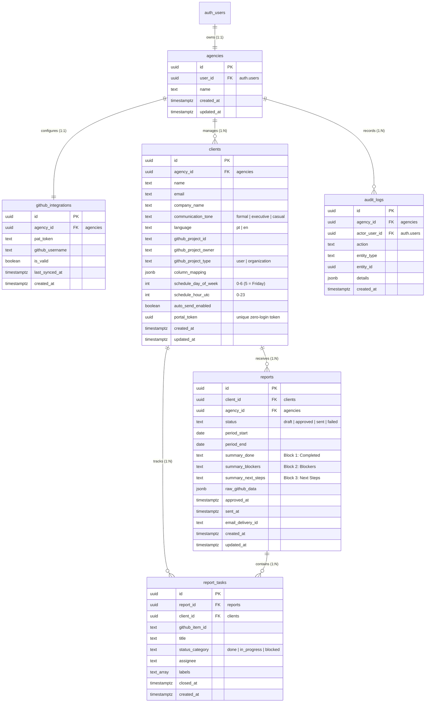

# Database Architecture & Security Guide — ClientPulse AI

## 1. Introduction for Beginners

Welcome to the ClientPulse AI database design! If you are transitioning from Firebase Firestore or MongoDB to **PostgreSQL with Supabase**, here are three essential concepts to keep in mind:

1. **Relational Tables vs. Document Collections:** Instead of storing flexible, nested documents, relational databases store data in structured tables with strict column types. Tables link to each other using **Foreign Keys** (`REFERENCES other_table(id)`).
2. **PostgreSQL as the Single Source of Truth:** Foreign keys prevent "orphaned" records. For example, if an agency deletes a client, `ON DELETE CASCADE` automatically and safely cleans up all associated reports and task metrics.
3. **Row Level Security (RLS):** In traditional backends, developers write authorization checks in their API controllers (e.g., `if (client.agency_id !== req.user.id) return 403`). In Supabase, the database itself enforces security rules directly at the row level! Even if a malicious user bypasses the API, PostgreSQL will refuse to return any row that does not belong to that user.

---

## 2. Entity-Relationship (ER) Diagram



---

## 3. Table Dictionary & Schema Specifications

### 3.1 `agencies`
Stores the agency or freelancer profile linked to a Supabase authenticated user.

| Column | Type | Constraints | Description |
| :--- | :--- | :--- | :--- |
| `id` | `UUID` | `PRIMARY KEY DEFAULT gen_random_uuid()` | Unique agency identifier. |
| `user_id` | `UUID` | `NOT NULL UNIQUE REFERENCES auth.users(id) ON DELETE CASCADE` | 1-to-1 link with the Supabase Auth user. |
| `name` | `TEXT` | `NOT NULL` | Business name or freelancer name. |
| `created_at` | `TIMESTAMPTZ`| `DEFAULT now()` | Creation timestamp. |
| `updated_at` | `TIMESTAMPTZ`| `DEFAULT now()` | Last update timestamp. |

**Indexes:**
- `CREATE INDEX idx_agencies_user_id ON agencies(user_id);`

**RLS Policy:**
```sql
ALTER TABLE agencies ENABLE ROW LEVEL SECURITY;

CREATE POLICY "Users can manage their own agency"
ON agencies FOR ALL
TO authenticated
USING (auth.uid() = user_id)
WITH CHECK (auth.uid() = user_id);
```
*Plain English:* When an authenticated user queries `agencies`, PostgreSQL only allows them to view or edit the agency record where `user_id` matches their own login ID (`auth.uid()`).

---

### 3.2 `github_integrations`
Stores the GitHub Personal Access Token (PAT) used to query the GitHub Projects v2 GraphQL API. Encrypted at rest via AES-256-GCM.

| Column | Type | Constraints | Description |
| :--- | :--- | :--- | :--- |
| `id` | `UUID` | `PRIMARY KEY DEFAULT gen_random_uuid()` | Unique integration record ID. |
| `agency_id` | `UUID` | `NOT NULL UNIQUE REFERENCES agencies(id) ON DELETE CASCADE` | Agency owning this PAT. |
| `pat_token` | `TEXT` | `NULL` | Deprecated plaintext column (kept nullable for legacy rollback). |
| `pat_token_encrypted` | `TEXT` | `NULL` | AES-256-GCM encrypted PAT (`iv:ciphertext`) encrypted using `PAT_ENCRYPTION_KEY`. |
| `github_username` | `TEXT` | `NULL` | GitHub handle of the authenticated user. |
| `is_valid` | `BOOLEAN` | `DEFAULT true` | Set to false if API returns 401 Bad Credentials. |
| `last_synced_at` | `TIMESTAMPTZ`| `NULL` | Timestamp of last successful GraphQL sync. |
| `created_at` | `TIMESTAMPTZ`| `DEFAULT now()` | Creation timestamp. |

**Indexes:**
- `CREATE INDEX idx_github_integrations_agency ON github_integrations(agency_id);`

**RLS & Column-Level Security (CLS) Policy (Migration 010):**
```sql
ALTER TABLE github_integrations ENABLE ROW LEVEL SECURITY;

-- 1. Row Level Security policy
CREATE POLICY "Agencies can manage their own GitHub integration"
ON github_integrations FOR ALL
TO authenticated
USING (agency_id IN (SELECT id FROM agencies WHERE user_id = auth.uid()))
WITH CHECK (agency_id IN (SELECT id FROM agencies WHERE user_id = auth.uid()));

-- 2. Column-Level Security restriction (Migration 010):
-- Browser/authenticated role cannot query pat_token or pat_token_encrypted
REVOKE SELECT ON TABLE public.github_integrations FROM authenticated;
GRANT SELECT (id, agency_id, github_username, is_valid, last_synced_at, created_at)
  ON TABLE public.github_integrations TO authenticated;
```
*Plain English:* Agency owners can manage their integrations, but browser clients are blocked by PostgreSQL from selecting the encrypted or plaintext PAT columns. Decryption happens strictly inside server-side Edge Functions.

---

### 3.3 `clients`
Represents client accounts managed by the agency. Contains report personalization settings and scheduling details.

| Column | Type | Constraints | Description |
| :--- | :--- | :--- | :--- |
| `id` | `UUID` | `PRIMARY KEY DEFAULT gen_random_uuid()` | Unique client identifier. |
| `agency_id` | `UUID` | `NOT NULL REFERENCES agencies(id) ON DELETE CASCADE` | Agency that owns this client. |
| `name` | `TEXT` | `NOT NULL` | Client contact person's name. |
| `email` | `TEXT` | `NOT NULL` | Recipient email address for reports. |
| `company_name` | `TEXT` | `NULL` | Client organization/company name. |
| `communication_tone` | `TEXT` | `NOT NULL DEFAULT 'executive' CHECK (communication_tone IN ('formal', 'executive', 'casual'))` | Tone of voice for Gemini prompts. |
| `language` | `TEXT` | `NOT NULL DEFAULT 'pt' CHECK (language IN ('pt', 'en'))` | Report output language. |
| `github_project_id` | `TEXT` | `NOT NULL` | Target GitHub Projects v2 ID / Number. |
| `github_project_owner` | `TEXT` | `NOT NULL` | GitHub Organization or User handle. |
| `github_project_type` | `TEXT` | `NOT NULL DEFAULT 'organization' CHECK (github_project_type IN ('user', 'organization'))` | Distinguishes `user(...)` vs `organization(...)` GraphQL root. |
| `column_mapping` | `JSONB` | `NOT NULL DEFAULT '{"done": ["Done"], "in_progress": ["In Progress"], "blocked": ["Blocked"]}'::jsonb` | Maps GitHub board columns to standard report categories. |
| `schedule_day_of_week` | `INT` | `DEFAULT 5 CHECK (schedule_day_of_week BETWEEN 0 AND 6)` | Day to generate/send (5 = Friday). |
| `schedule_hour_utc` | `INT` | `DEFAULT 9 CHECK (schedule_hour_utc BETWEEN 0 AND 23)` | Hour in UTC to execute the report. |
| `auto_send_enabled` | `BOOLEAN` | `DEFAULT false` | If true, dispatches email immediately without waiting for manual dashboard approval. |
| `portal_token` | `UUID` | `NOT NULL UNIQUE DEFAULT gen_random_uuid()` | High-entropy token allowing the client zero-login portal access. |
| `created_at` | `TIMESTAMPTZ`| `DEFAULT now()` | Creation timestamp. |
| `updated_at` | `TIMESTAMPTZ`| `DEFAULT now()` | Last update timestamp. |

**Indexes:**
- `CREATE INDEX idx_clients_agency ON clients(agency_id);`
- `CREATE INDEX idx_clients_portal_token ON clients(portal_token);`
- `CREATE INDEX idx_clients_schedule ON clients(schedule_day_of_week, schedule_hour_utc);`

**RLS Policy:**
```sql
ALTER TABLE clients ENABLE ROW LEVEL SECURITY;

CREATE POLICY "Agencies can manage their clients"
ON clients FOR ALL
TO authenticated
USING (agency_id IN (SELECT id FROM agencies WHERE user_id = auth.uid()))
WITH CHECK (agency_id IN (SELECT id FROM agencies WHERE user_id = auth.uid()));
```
*Plain English:* Agency users can only CRUD their own clients. The `portal_token` is hidden from the general public and can only be queried via the token-gated Edge Function using `service_role`.

---

### 3.4 `reports`
Stores every weekly progress report draft, approved version, and delivery metadata.

| Column | Type | Constraints | Description |
| :--- | :--- | :--- | :--- |
| `id` | `UUID` | `PRIMARY KEY DEFAULT gen_random_uuid()` | Unique report identifier. |
| `client_id` | `UUID` | `NOT NULL REFERENCES clients(id) ON DELETE CASCADE` | Target client. |
| `agency_id` | `UUID` | `NOT NULL REFERENCES agencies(id) ON DELETE CASCADE` | Agency workspace. |
| `status` | `TEXT` | `NOT NULL DEFAULT 'draft' CHECK (status IN ('draft', 'approved', 'sent', 'failed'))` | Report lifecycle status. |
| `period_start` | `DATE` | `NOT NULL` | Start date of the 7-day reporting period. |
| `period_end` | `DATE` | `NOT NULL` | End date of the 7-day reporting period. |
| `summary_done` | `TEXT` | `NOT NULL` | Block 1: Tasks completed in plain business language. |
| `summary_blockers`| `TEXT` | `NOT NULL` | Block 2: Obstacles and attention points. |
| `summary_next_steps`| `TEXT`| `NOT NULL` | Block 3: Upcoming decisions and deliverables. |
| `raw_github_data` | `JSONB` | `NULL` | Snapshot of raw task items from GitHub GraphQL. |
| `approved_at` | `TIMESTAMPTZ`| `NULL` | Timestamp when manager clicked "Approve and Send". |
| `sent_at` | `TIMESTAMPTZ`| `NULL` | Timestamp when Resend successfully dispatched the email. |
| `opened_at` | `TIMESTAMPTZ`| `NULL` | Timestamp of the first email/portal opening (BE-21, idempotent). |
| `email_delivery_id`| `TEXT`| `NULL` | Resend message ID for delivery tracking. |
| `created_at` | `TIMESTAMPTZ`| `DEFAULT now()` | Generation timestamp. |
| `updated_at` | `TIMESTAMPTZ`| `DEFAULT now()` | Last update timestamp. |

**Indexes:**
- `CREATE INDEX idx_reports_client ON reports(client_id);`
- `CREATE INDEX idx_reports_agency_status ON reports(agency_id, status);`
- `CREATE INDEX idx_reports_period ON reports(period_end DESC);`

**RLS Policy:**
```sql
ALTER TABLE reports ENABLE ROW LEVEL SECURITY;

CREATE POLICY "Agencies can manage their reports"
ON reports FOR ALL
TO authenticated
USING (agency_id IN (SELECT id FROM agencies WHERE user_id = auth.uid()))
WITH CHECK (agency_id IN (SELECT id FROM agencies WHERE user_id = auth.uid()));
```
*Plain English:* Agency managers have full CRUD rights over their reports. Clients access sent reports through the token-validating RPC, called by Next SSR or the Edge endpoint.

---

### 3.5 `report_tasks`
Normalized record of individual GitHub cards associated with a report. Used by the client portal to display sprint delivery metrics (tasks completed per sprint).

| Column | Type | Constraints | Description |
| :--- | :--- | :--- | :--- |
| `id` | `UUID` | `PRIMARY KEY DEFAULT gen_random_uuid()` | Unique task record ID. |
| `report_id` | `UUID` | `NOT NULL REFERENCES reports(id) ON DELETE CASCADE` | Linked report. |
| `client_id` | `UUID` | `NOT NULL REFERENCES clients(id) ON DELETE CASCADE` | Linked client. |
| `github_item_id` | `TEXT` | `NOT NULL` | GitHub item node ID. |
| `title` | `TEXT` | `NOT NULL` | Card title. |
| `status_category` | `TEXT` | `NOT NULL CHECK (status_category IN ('done', 'in_progress', 'blocked'))` | Normalized status. |
| `assignee` | `TEXT` | `NULL` | GitHub username of the assignee. |
| `labels` | `TEXT[]` | `DEFAULT '{}'` | Array of GitHub label names. |
| `closed_at` | `TIMESTAMPTZ`| `NULL` | When the card/issue was marked closed. |
| `created_at` | `TIMESTAMPTZ`| `DEFAULT now()` | Creation timestamp. |

**Indexes:**
- `CREATE INDEX idx_report_tasks_report ON report_tasks(report_id);`
- `CREATE INDEX idx_report_tasks_client_status ON report_tasks(client_id, status_category);`

**RLS Policy:**
```sql
ALTER TABLE report_tasks ENABLE ROW LEVEL SECURITY;

CREATE POLICY "Agencies can view their report tasks"
ON report_tasks FOR ALL
TO authenticated
USING (
  report_id IN (
    SELECT r.id FROM reports r
    JOIN agencies a ON r.agency_id = a.id
    WHERE a.user_id = auth.uid()
  )
);
```

---

## 4. Tabelas Adicionais (Migration 003)

### 4.1 `profiles`
Perfil do utilizador ligado 1:1 ao `auth.users` e à agência criada no signup.

| Coluna | Tipo | Restrições | Descrição |
| :--- | :--- | :--- | :--- |
| `id` | `UUID` | `PRIMARY KEY REFERENCES auth.users(id)` | Mesmo UUID do utilizador Supabase Auth. |
| `agency_id` | `UUID` | `REFERENCES agencies(id) ON DELETE SET NULL` | Agência do utilizador. |
| `full_name` | `TEXT` | `NULL` | Nome completo. |
| `email` | `TEXT` | `NULL` | E-mail (espelho de auth.users). |
| `avatar_url` | `TEXT` | `NULL` | URL de avatar (OAuth). |
| `role` | `TEXT` | `DEFAULT 'owner'` | Papel na agência (owner, admin, etc.). |

**RLS:** SELECT e UPDATE apenas para o próprio utilizador (`id = auth.uid()`).

---

### 4.2 `sprint_metrics`
Métricas de velocidade de sprint por cliente. Usadas no dashboard e no portal do cliente.

| Coluna | Tipo | Restrições | Descrição |
| :--- | :--- | :--- | :--- |
| `id` | `UUID` | `PRIMARY KEY` | Identificador único. |
| `client_id` | `UUID` | `NOT NULL REFERENCES clients(id)` | Cliente associado. |
| `agency_id` | `UUID` | `NOT NULL REFERENCES agencies(id)` | Agência proprietária. |
| `sprint` | `TEXT` | `NOT NULL` | Código do sprint (ex: `S42`). |
| `label` | `TEXT` | `NOT NULL` | Etiqueta legível (ex: `Semana 42`). |
| `completed` | `INT` | `DEFAULT 0` | Tarefas concluídas. |
| `planned` | `INT` | `DEFAULT 0` | Tarefas planeadas. |

**RLS:** CRUD completo para a agência proprietária (`agency_id`). Leitura anónima via portal token.

---

### 4.3 `portal_tokens` (BE-19 Magic Links — Migrations 003 & 009)
Tabela dedicada à gestão de tokens de portal com suporte a revogação, expiração configurável (por defeito 90 dias) e validação fail-closed.

| Coluna | Tipo | Restrições | Descrição |
| :--- | :--- | :--- | :--- |
| `id` | `UUID` | `PRIMARY KEY DEFAULT gen_random_uuid()` | Identificador único. |
| `client_id` | `UUID` | `NOT NULL REFERENCES clients(id) ON DELETE CASCADE` | Cliente a que pertence. |
| `agency_id` | `UUID` | `NOT NULL REFERENCES agencies(id) ON DELETE CASCADE` | Agência proprietária. |
| `token` | `UUID` | `NOT NULL UNIQUE` | Token de acesso gerado aleatoriamente (UUIDv4). |
| `is_active` | `BOOLEAN` | `DEFAULT true` | `false` após revogação manual ou renovação. |
| `expires_at` | `TIMESTAMPTZ` | `DEFAULT (now() + INTERVAL '90 days')` | Data de expiração (90 dias por defeito). |
| `revoked_at` | `TIMESTAMPTZ` | `NULL` | Carimbo horário de revogação (`now()` se revogado). |
| `created_at` | `TIMESTAMPTZ` | `DEFAULT now()` | Data de criação do token. |

**Validação Fail-Closed via RPC (`get_portal_data_by_token`):**
O acesso ao portal público utiliza a função `SECURITY DEFINER` `get_portal_data_by_token(UUID)` que valida:
1. `is_active = true`
2. `revoked_at IS NULL`
3. `expires_at IS NULL OR expires_at > now()` (legacy NULL allowed; pending hardening)
Se qualquer uma das condições falhar, o RPC retorna `NULL`. A função auxiliar `check_portal_token_status(UUID)` devolve `'valid'`, `'expired'`, `'revoked'`, ou `'not_found'` para apresentação de mensagens contextuais seguras no frontend.

**Renovação no Dashboard:**
A ação `renewClientPortalToken` marca os tokens anteriores do cliente como `is_active = false, revoked_at = now()` e insere um novo registo ativo com validade de 90 dias, atualizando `clients.portal_token`.

---

### 4.4 `delivery_logs`
Registo de auditoria de cada envio de e-mail transaccional (Resend API).

| Coluna | Tipo | Restrições | Descrição |
| :--- | :--- | :--- | :--- |
| `id` | `UUID` | `PRIMARY KEY` | Identificador único. |
| `report_id` | `UUID` | `REFERENCES reports(id) ON DELETE SET NULL` | Relatório enviado. |
| `client_id` | `UUID` | `NOT NULL REFERENCES clients(id)` | Destinatário. |
| `agency_id` | `UUID` | `NOT NULL REFERENCES agencies(id)` | Agência remetente. |
| `status` | `TEXT` | `CHECK (status IN ('sent','delivered','bounced','failed'))` | Estado da entrega. |
| `email_service` | `TEXT` | `DEFAULT 'resend'` | Serviço de e-mail usado. |
| `recipient_email`| `TEXT` | `NOT NULL` | Endereço de destino. |
| `message_id` | `TEXT` | `NULL` | ID externo do Resend. |
| `error_message` | `TEXT` | `NULL` | Detalhe do erro, se falhou. |
| `sent_at` | `TIMESTAMPTZ` | `DEFAULT now()` | Timestamp de envio. |

**RLS:** SELECT e INSERT para a agência proprietária. UPDATE reservado ao `service_role` (Edge Functions).

---

### 4.5 `audit_logs` (BE-04 Minimal Audit Logging — Migration 013)
Tabela de auditoria imutável que regista eventos operacionais críticos da agência sem expor credenciais ou segredos.

| Coluna | Tipo | Restrições | Descrição |
| :--- | :--- | :--- | :--- |
| `id` | `UUID` | `PRIMARY KEY DEFAULT gen_random_uuid()` | Identificador único do log. |
| `agency_id` | `UUID` | `NOT NULL REFERENCES agencies(id) ON DELETE CASCADE` | Agência proprietária do registo. |
| `actor_user_id` | `UUID` | `NULL REFERENCES auth.users(id) ON DELETE SET NULL` | Utilizador (`auth.uid()`) que disparou a ação, ou `NULL` em rotinas de background/cron. |
| `action` | `TEXT` | `NOT NULL` | Tipo de evento (ex: `report_created`, `report_approved`, `portal_token_created`, `portal_token_revoked`, `client_created`, `client_schedule_updated`, `github_integration_connected`). |
| `entity_type` | `TEXT` | `NOT NULL` | Entidade afetada (`report`, `portal_token`, `client`, `github_integration`). |
| `entity_id` | `UUID` | `NOT NULL` | ID da entidade afetada. |
| `details` | `JSONB` | `NOT NULL DEFAULT '{}'::jsonb` | Metadados contextuais (ex: estados anterior/novo, agendamento alterado). |
| `created_at` | `TIMESTAMPTZ` | `NOT NULL DEFAULT now()` | Carimbo temporal do evento. |

**Garantias de Privacidade e Segurança:**
- O campo `details` é estritamente higienizado pelos triggers: **nunca** armazena PATs, texto cifrado (`pat_token_encrypted`) nem tokens do portal (`portal_token`).
- **RLS:** A agência só tem permissão de leitura (`SELECT`) sobre os seus próprios registos (`agency_id = public.get_my_agency_id()`).
- **Bloqueio de Escrita na Aplicação:** `REVOKE INSERT, UPDATE, DELETE FROM authenticated, anon, public;` — as inserções são geradas exclusivamente por triggers internos `SECURITY DEFINER` com `search_path = public`.

---

## 5. Row Level Security — Referência Completa (BE-02)

### 5.1 Visão Geral

| Tabela | RLS Activo | Políticas Authenticated | Acesso Anónimo (Portal) |
| :--- | :---: | :--- | :---: |
| `agencies` | ✅ | SELECT, INSERT, UPDATE (próprio `user_id`) | ❌ |
| `github_integrations` | ✅ | SELECT, ALL (via `agency_id`) | ❌ |
| `clients` | ✅ | SELECT, INSERT, UPDATE, DELETE (via `agency_id`) | SELECT via portal token |
| `reports` | ✅ | SELECT, INSERT, UPDATE, DELETE (via `agency_id`) | SELECT via portal token |
| `report_tasks` | ✅ | ALL (via `report.agency_id`, com WITH CHECK) | SELECT via portal token |
| `profiles` | ✅ | SELECT, INSERT, UPDATE (próprio `id`) | ❌ |
| `sprint_metrics` | ✅ | SELECT, ALL (via `agency_id`) | SELECT via portal token |
| `portal_tokens` | ✅ | ALL (via `agency_id`) | ❌ |
| `delivery_logs` | ✅ | SELECT, INSERT (via `agency_id`) + UPDATE via `service_role` | ❌ |

### 5.2 Função Auxiliar `get_my_agency_id()`

```sql
CREATE OR REPLACE FUNCTION public.get_my_agency_id()
RETURNS UUID
LANGUAGE SQL SECURITY DEFINER STABLE
SET search_path = public
AS $$
  SELECT id FROM public.agencies WHERE user_id = auth.uid();
$$;
```

**Propósito:** Evita subqueries repetidas por linha em cada avaliação de política RLS.
**`SECURITY DEFINER`:** Executa com privilégios do owner, não do chamador — permite acesso seguro à tabela `agencies`.
**`STABLE`:** O resultado é constante dentro de uma transacção — o query planner pode fazer cache.

### 5.3 Padrão de Isolamento por Agência

Todas as tabelas com `agency_id` usam este padrão:

```sql
-- Para USING (leitura):
agency_id = public.get_my_agency_id()

-- Para WITH CHECK (escrita):
agency_id = public.get_my_agency_id()
```

### 5.4 Anonymous portal access (current implementation)

The Next server-rendered `/portal/[token]` route calls `get_portal_data_by_token(UUID)`. The optional `client-portal-data` Edge endpoint calls the same RPC. Migration 005 removed direct anonymous table SELECT; the old anonymous policies from 004 are not an active second line of defence.

The RPC validates an active, non-revoked token, accepting future **or NULL** expiry, and publishes only `sent` report text. The latest security migration removes raw GitHub data and delivery identifiers. It still returns broader client metadata and metrics; see the residual risks in [FINAL_AUDIT.md](FINAL_AUDIT.md). `record_portal_report_open` requires a future, non-NULL expiry.

### 5.5 Como Testar o Isolamento RLS

Executar o script completo apenas numa base de dados local/de testes descartável:

**Ficheiro:** [`supabase/tests/rls_isolation_test.sql`](../supabase/tests/rls_isolation_test.sql)

```sql
-- Verificação rápida das políticas activas:
SELECT tablename, policyname, roles, cmd
FROM pg_policies
WHERE schemaname = 'public'
ORDER BY tablename, cmd;

-- Verificação do RLS estar activo em todas as tabelas:
SELECT relname AS table_name, relrowsecurity AS rls_enabled
FROM pg_class
JOIN pg_namespace ON pg_namespace.oid = pg_class.relnamespace
WHERE pg_namespace.nspname = 'public' AND relkind = 'r'
ORDER BY relname;
```

**Checks defined, not results of execution:** agency A/B read and update isolation (1–7); valid/invalid token and anonymous direct SELECT (8–10); encrypted PAT column denial and permitted integration fields (11–12); audit log isolation, write denial and trigger logging (13–15).

### 5.6 Migration inventory (15 files)

The ordered SQL files are authoritative; earlier snippets describe individual migrations and are not a replacement for applying the full chain to a fresh test database.

| Migration | File |
| :--- | :--- |
| `001_initial_schema` | [SQL](../supabase/migrations/001_initial_schema.sql) |
| `002_cron_scheduler` | [SQL](../supabase/migrations/002_cron_scheduler.sql) |
| `003_be_01_complete_schema` | [SQL](../supabase/migrations/003_be_01_complete_schema.sql) |
| `004_be_02_rls_policies` | [SQL](../supabase/migrations/004_be_02_rls_policies.sql) |
| `005_be_02_portal_rpc` | [SQL](../supabase/migrations/005_be_02_portal_rpc.sql) |
| `006_be_25_sprint_metrics` | [SQL](../supabase/migrations/006_be_25_sprint_metrics.sql) |
| `007_be_19_encrypt_pat` | [SQL](../supabase/migrations/007_be_19_encrypt_pat.sql) |
| `008_be_21_opened_at` | [SQL](../supabase/migrations/008_be_21_opened_at.sql) |
| `009_be_19_magic_links` | [SQL](../supabase/migrations/009_be_19_magic_links.sql) |
| `010_restrict_pat_access` | [SQL](../supabase/migrations/010_restrict_pat_access.sql) |
| `011_be_29_success_metrics` | [SQL](../supabase/migrations/011_be_29_success_metrics.sql) |
| `012_project_title_and_active_review_time` | [SQL](../supabase/migrations/012_project_title_and_active_review_time.sql) |
| `013_be_04_audit_logs` | [SQL](../supabase/migrations/013_be_04_audit_logs.sql) |
| `20261117201502_secure_rpc_portal_and_privileges` | [SQL](../supabase/migrations/20261117201502_secure_rpc_portal_and_privileges.sql) |
| `20261117202004_harden_function_search_path_and_fk_indexes` | [SQL](../supabase/migrations/20261117202004_harden_function_search_path_and_fk_indexes.sql) |

### 5.7 Later schema and validation boundaries

Migration 011 adds onboarding timestamps, report editing/approval telemetry and `success_metrics`; 012 adds `github_project_title` and `review_opened_at` and updates the view/RPC; 013 adds audit logging. The view is `security_invoker`, so its caller's RLS applies. Consult these migrations for the complete later-column dictionary.

The SQL isolation script contains 15 checks, now wrapped in BEGIN/ROLLBACK with generated test IDs. Permission-denied cases no longer catch their own failure assertions. Run only against a disposable local/test database. No PostgreSQL/Docker runtime was available in this audit, so SQL checks are **not executed** and no 10/10 or 15/15 result is claimed.

RLS checks agency ownership, but separate foreign keys do not prove that each referenced client/report belongs to that same agency. Composite tenant foreign keys, tighter portal projection, NULL-expiry policy and year-aware sprint keys require a reviewed migration and real SQL regressions. No production schema was changed.
