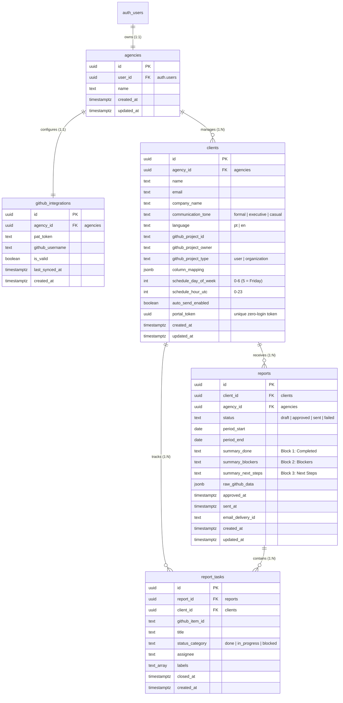

# Database Architecture & Security Guide — ClientPulse AI

## 1. Introduction for Beginners

Welcome to the ClientPulse AI database design! If you are transitioning from Firebase Firestore or MongoDB to **PostgreSQL with Supabase**, here are three essential concepts to keep in mind:

1. **Relational Tables vs. Document Collections:** Instead of storing flexible, nested documents, relational databases store data in structured tables with strict column types. Tables link to each other using **Foreign Keys** (`REFERENCES other_table(id)`).
2. **PostgreSQL as the Single Source of Truth:** Foreign keys prevent "orphaned" records. For example, if an agency deletes a client, `ON DELETE CASCADE` automatically and safely cleans up all associated reports and task metrics.
3. **Row Level Security (RLS):** In traditional backends, developers write authorization checks in their API controllers (e.g., `if (client.agency_id !== req.user.id) return 403`). In Supabase, the database itself enforces security rules directly at the row level! Even if a malicious user bypasses the API, PostgreSQL will refuse to return any row that does not belong to that user.

---

## 2. Entity-Relationship (ER) Diagram



---

## 3. Table Dictionary & Schema Specifications

### 3.1 `agencies`
Stores the agency or freelancer profile linked to a Supabase authenticated user.

| Column | Type | Constraints | Description |
| :--- | :--- | :--- | :--- |
| `id` | `UUID` | `PRIMARY KEY DEFAULT gen_random_uuid()` | Unique agency identifier. |
| `user_id` | `UUID` | `NOT NULL UNIQUE REFERENCES auth.users(id) ON DELETE CASCADE` | 1-to-1 link with the Supabase Auth user. |
| `name` | `TEXT` | `NOT NULL` | Business name or freelancer name. |
| `created_at` | `TIMESTAMPTZ`| `DEFAULT now()` | Creation timestamp. |
| `updated_at` | `TIMESTAMPTZ`| `DEFAULT now()` | Last update timestamp. |

**Indexes:**
- `CREATE INDEX idx_agencies_user_id ON agencies(user_id);`

**RLS Policy:**
```sql
ALTER TABLE agencies ENABLE ROW LEVEL SECURITY;

CREATE POLICY "Users can manage their own agency"
ON agencies FOR ALL
TO authenticated
USING (auth.uid() = user_id)
WITH CHECK (auth.uid() = user_id);
```
*Plain English:* When an authenticated user queries `agencies`, PostgreSQL only allows them to view or edit the agency record where `user_id` matches their own login ID (`auth.uid()`).

---

### 3.2 `github_integrations`
Stores the GitHub Personal Access Token (PAT) used to query the GitHub Projects v2 GraphQL API.

| Column | Type | Constraints | Description |
| :--- | :--- | :--- | :--- |
| `id` | `UUID` | `PRIMARY KEY DEFAULT gen_random_uuid()` | Unique integration record ID. |
| `agency_id` | `UUID` | `NOT NULL UNIQUE REFERENCES agencies(id) ON DELETE CASCADE` | Agency owning this PAT. |
| `pat_token` | `TEXT` | `NOT NULL` | Fine-grained GitHub PAT (`read:project` and `repo` read-only). |
| `github_username` | `TEXT` | `NULL` | GitHub handle of the authenticated user. |
| `is_valid` | `BOOLEAN` | `DEFAULT true` | Set to false if API returns 401 Bad Credentials. |
| `last_synced_at` | `TIMESTAMPTZ`| `NULL` | Timestamp of last successful GraphQL sync. |
| `created_at` | `TIMESTAMPTZ`| `DEFAULT now()` | Creation timestamp. |

**Indexes:**
- `CREATE INDEX idx_github_integrations_agency ON github_integrations(agency_id);`

**RLS Policy:**
```sql
ALTER TABLE github_integrations ENABLE ROW LEVEL SECURITY;

CREATE POLICY "Agencies can manage their own GitHub integration"
ON github_integrations FOR ALL
TO authenticated
USING (agency_id IN (SELECT id FROM agencies WHERE user_id = auth.uid()))
WITH CHECK (agency_id IN (SELECT id FROM agencies WHERE user_id = auth.uid()));
```
*Plain English:* Only the agency owner can view or update their stored PAT token.

---

### 3.3 `clients`
Represents client accounts managed by the agency. Contains report personalization settings and scheduling details.

| Column | Type | Constraints | Description |
| :--- | :--- | :--- | :--- |
| `id` | `UUID` | `PRIMARY KEY DEFAULT gen_random_uuid()` | Unique client identifier. |
| `agency_id` | `UUID` | `NOT NULL REFERENCES agencies(id) ON DELETE CASCADE` | Agency that owns this client. |
| `name` | `TEXT` | `NOT NULL` | Client contact person's name. |
| `email` | `TEXT` | `NOT NULL` | Recipient email address for reports. |
| `company_name` | `TEXT` | `NULL` | Client organization/company name. |
| `communication_tone` | `TEXT` | `NOT NULL DEFAULT 'executive' CHECK (communication_tone IN ('formal', 'executive', 'casual'))` | Tone of voice for Gemini prompts. |
| `language` | `TEXT` | `NOT NULL DEFAULT 'pt' CHECK (language IN ('pt', 'en'))` | Report output language. |
| `github_project_id` | `TEXT` | `NOT NULL` | Target GitHub Projects v2 ID / Number. |
| `github_project_owner` | `TEXT` | `NOT NULL` | GitHub Organization or User handle. |
| `github_project_type` | `TEXT` | `NOT NULL DEFAULT 'organization' CHECK (github_project_type IN ('user', 'organization'))` | Distinguishes `user(...)` vs `organization(...)` GraphQL root. |
| `column_mapping` | `JSONB` | `NOT NULL DEFAULT '{"done": ["Done"], "in_progress": ["In Progress"], "blocked": ["Blocked"]}'::jsonb` | Maps GitHub board columns to standard report categories. |
| `schedule_day_of_week` | `INT` | `DEFAULT 5 CHECK (schedule_day_of_week BETWEEN 0 AND 6)` | Day to generate/send (5 = Friday). |
| `schedule_hour_utc` | `INT` | `DEFAULT 9 CHECK (schedule_hour_utc BETWEEN 0 AND 23)` | Hour in UTC to execute the report. |
| `auto_send_enabled` | `BOOLEAN` | `DEFAULT false` | If true, dispatches email immediately without waiting for manual dashboard approval. |
| `portal_token` | `UUID` | `NOT NULL UNIQUE DEFAULT gen_random_uuid()` | High-entropy token allowing the client zero-login portal access. |
| `created_at` | `TIMESTAMPTZ`| `DEFAULT now()` | Creation timestamp. |
| `updated_at` | `TIMESTAMPTZ`| `DEFAULT now()` | Last update timestamp. |

**Indexes:**
- `CREATE INDEX idx_clients_agency ON clients(agency_id);`
- `CREATE INDEX idx_clients_portal_token ON clients(portal_token);`
- `CREATE INDEX idx_clients_schedule ON clients(schedule_day_of_week, schedule_hour_utc);`

**RLS Policy:**
```sql
ALTER TABLE clients ENABLE ROW LEVEL SECURITY;

CREATE POLICY "Agencies can manage their clients"
ON clients FOR ALL
TO authenticated
USING (agency_id IN (SELECT id FROM agencies WHERE user_id = auth.uid()))
WITH CHECK (agency_id IN (SELECT id FROM agencies WHERE user_id = auth.uid()));
```
*Plain English:* Agency users can only CRUD their own clients. The `portal_token` is hidden from the general public and can only be queried via the token-gated Edge Function using `service_role`.

---

### 3.4 `reports`
Stores every weekly progress report draft, approved version, and delivery metadata.

| Column | Type | Constraints | Description |
| :--- | :--- | :--- | :--- |
| `id` | `UUID` | `PRIMARY KEY DEFAULT gen_random_uuid()` | Unique report identifier. |
| `client_id` | `UUID` | `NOT NULL REFERENCES clients(id) ON DELETE CASCADE` | Target client. |
| `agency_id` | `UUID` | `NOT NULL REFERENCES agencies(id) ON DELETE CASCADE` | Agency workspace. |
| `status` | `TEXT` | `NOT NULL DEFAULT 'draft' CHECK (status IN ('draft', 'approved', 'sent', 'failed'))` | Report lifecycle status. |
| `period_start` | `DATE` | `NOT NULL` | Start date of the 7-day reporting period. |
| `period_end` | `DATE` | `NOT NULL` | End date of the 7-day reporting period. |
| `summary_done` | `TEXT` | `NOT NULL` | Block 1: Tasks completed in plain business language. |
| `summary_blockers`| `TEXT` | `NOT NULL` | Block 2: Obstacles and attention points. |
| `summary_next_steps`| `TEXT`| `NOT NULL` | Block 3: Upcoming decisions and deliverables. |
| `raw_github_data` | `JSONB` | `NULL` | Snapshot of raw task items from GitHub GraphQL. |
| `approved_at` | `TIMESTAMPTZ`| `NULL` | Timestamp when manager clicked "Approve and Send". |
| `sent_at` | `TIMESTAMPTZ`| `NULL` | Timestamp when Resend successfully dispatched the email. |
| `email_delivery_id`| `TEXT`| `NULL` | Resend message ID for delivery tracking. |
| `created_at` | `TIMESTAMPTZ`| `DEFAULT now()` | Generation timestamp. |
| `updated_at` | `TIMESTAMPTZ`| `DEFAULT now()` | Last update timestamp. |

**Indexes:**
- `CREATE INDEX idx_reports_client ON reports(client_id);`
- `CREATE INDEX idx_reports_agency_status ON reports(agency_id, status);`
- `CREATE INDEX idx_reports_period ON reports(period_end DESC);`

**RLS Policy:**
```sql
ALTER TABLE reports ENABLE ROW LEVEL SECURITY;

CREATE POLICY "Agencies can manage their reports"
ON reports FOR ALL
TO authenticated
USING (agency_id IN (SELECT id FROM agencies WHERE user_id = auth.uid()))
WITH CHECK (agency_id IN (SELECT id FROM agencies WHERE user_id = auth.uid()));
```
*Plain English:* Agency managers have full CRUD rights over their reports. Clients access their reports through the secure `/client-portal-data` Edge Function.

---

### 3.5 `report_tasks`
Normalized record of individual GitHub cards associated with a report. Used by the client portal to display sprint delivery metrics (tasks completed per sprint).

| Column | Type | Constraints | Description |
| :--- | :--- | :--- | :--- |
| `id` | `UUID` | `PRIMARY KEY DEFAULT gen_random_uuid()` | Unique task record ID. |
| `report_id` | `UUID` | `NOT NULL REFERENCES reports(id) ON DELETE CASCADE` | Linked report. |
| `client_id` | `UUID` | `NOT NULL REFERENCES clients(id) ON DELETE CASCADE` | Linked client. |
| `github_item_id` | `TEXT` | `NOT NULL` | GitHub item node ID. |
| `title` | `TEXT` | `NOT NULL` | Card title. |
| `status_category` | `TEXT` | `NOT NULL CHECK (status_category IN ('done', 'in_progress', 'blocked'))` | Normalized status. |
| `assignee` | `TEXT` | `NULL` | GitHub username of the assignee. |
| `labels` | `TEXT[]` | `DEFAULT '{}'` | Array of GitHub label names. |
| `closed_at` | `TIMESTAMPTZ`| `NULL` | When the card/issue was marked closed. |
| `created_at` | `TIMESTAMPTZ`| `DEFAULT now()` | Creation timestamp. |

**Indexes:**
- `CREATE INDEX idx_report_tasks_report ON report_tasks(report_id);`
- `CREATE INDEX idx_report_tasks_client_status ON report_tasks(client_id, status_category);`

**RLS Policy:**
```sql
ALTER TABLE report_tasks ENABLE ROW LEVEL SECURITY;

CREATE POLICY "Agencies can view their report tasks"
ON report_tasks FOR ALL
TO authenticated
USING (
  report_id IN (
    SELECT r.id FROM reports r
    JOIN agencies a ON r.agency_id = a.id
    WHERE a.user_id = auth.uid()
  )
);
```

---

## 4. How to Test Row Level Security (RLS) Isolation

To prove that Row Level Security works properly and User B cannot access User A's data, run this test script in the Supabase SQL Editor:

```sql
-- Step 1: Create two fake users in Supabase Auth (or simulate them)
-- Replace with actual UUIDs from your auth.users table during testing
DO $$
DECLARE
  user_a UUID := '11111111-1111-1111-1111-111111111111';
  user_b UUID := '22222222-2222-2222-2222-222222222222';
  agency_a UUID;
  client_a UUID;
BEGIN
  -- Insert agency for User A
  INSERT INTO agencies (user_id, name) VALUES (user_a, 'Agency A')
  RETURNING id INTO agency_a;

  -- Insert client for Agency A
  INSERT INTO clients (agency_id, name, email, github_project_id, github_project_owner)
  VALUES (agency_a, 'Acme Corp', 'acme@example.com', 'PVT_123', 'acme-org')
  RETURNING id INTO client_a;

  -- Step 2: Simulate logging in as User B
  SET LOCAL ROLE authenticated;
  PERFORM set_config('request.jwt.claim.sub', user_b::text, true);

  -- Step 3: Attempt to read User A's clients
  -- This query MUST return 0 rows!
  IF EXISTS (SELECT 1 FROM clients WHERE id = client_a) THEN
    RAISE EXCEPTION 'RLS FAILED: User B was able to read User A clients!';
  ELSE
    RAISE NOTICE 'RLS SUCCESS: User B cannot see User A data.';
  END IF;
END $$;
```
